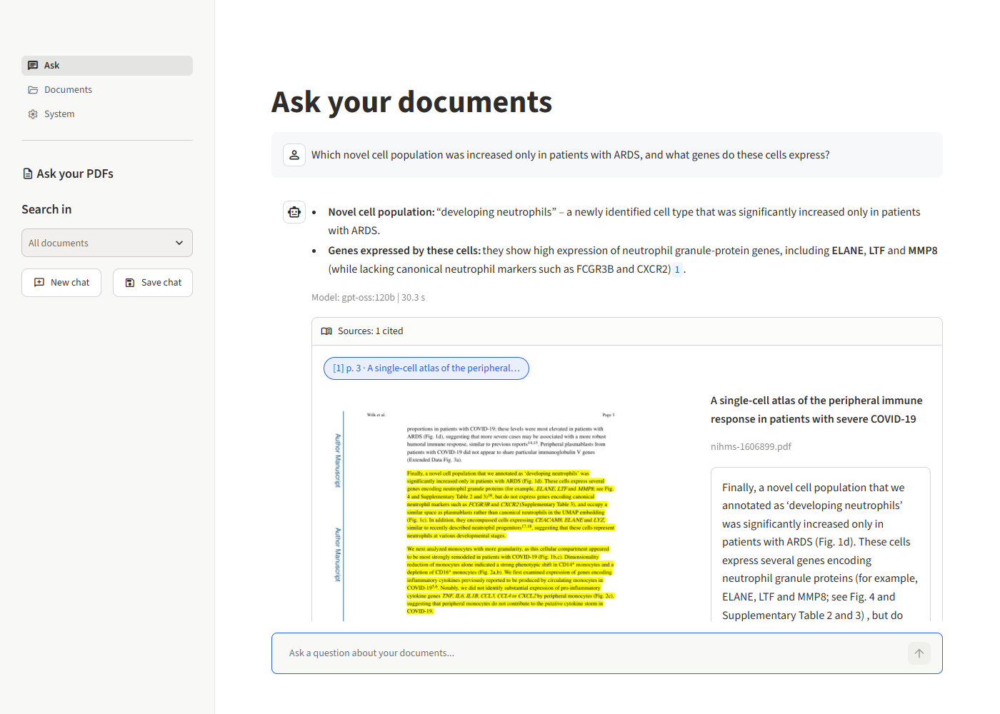
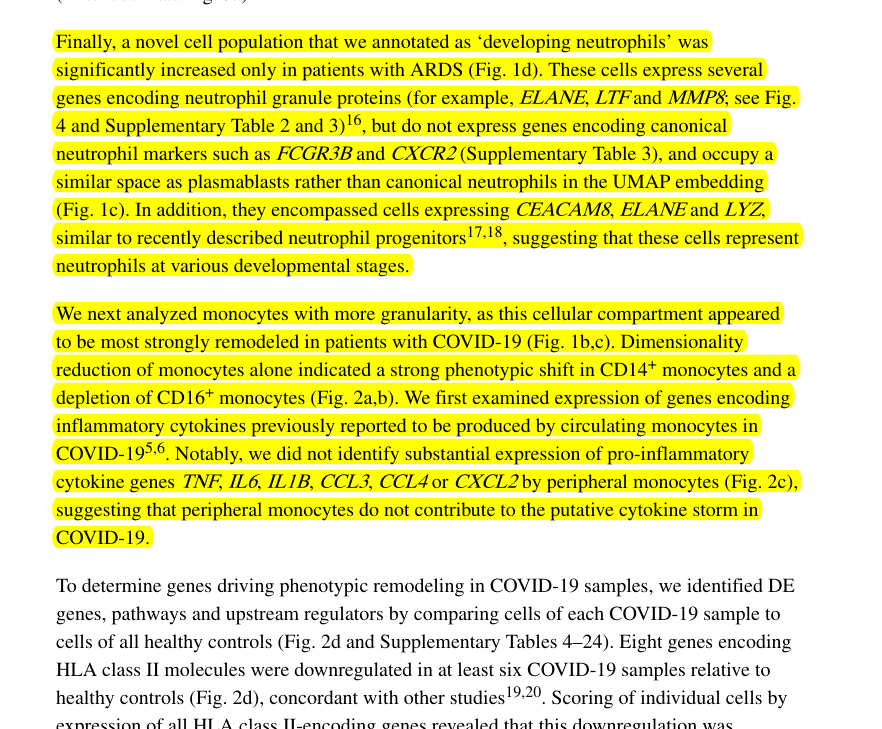

# PDF RAG: private, cited question answering over your documents

Ask questions about your PDFs in plain language and get **grounded answers with file and page citations**. It runs **entirely on your own hardware** with open-weight models served by [Ollama](https://ollama.com). The same codebase scales from a 2-core laptop to a multi-GPU server through **hardware profiles** that are chosen automatically.



*A real answer from `gpt-oss:120b`. Each `[n]` citation opens the original PDF page with the supporting passage highlighted, so users can verify the answer in seconds.*

## Highlights

- **Web app for non-technical users** (Streamlit): streaming chat with follow-up questions, drag-and-drop PDF upload with progress, document library, model switcher, and an **evidence viewer** that shows the cited PDF page with the passage highlighted ([details below](#the-web-app)).
- **Hybrid retrieval**: dense embeddings + BM25 sparse vectors fused with Reciprocal Rank Fusion in a single Qdrant query.
- **Cross-encoder reranking** (ONNX, CPU-friendly) over a wide candidate set.
- **Structure-aware ingestion**: Markdown extraction with PyMuPDF4LLM. Removes running headers, footers, page numbers and figure text, detects and drops bibliographies, keeps meaningful superscripts ("HLA-DR<sup>lo</sup>", "CD14<sup>+</sup>"), splits on headings and paragraphs with overlap, and tracks page ranges for citations.
- **Selective OCR** (RapidOCR, CPU): scanned pages and tables saved as images become searchable text. Figures are skipped by a cheap pixel test (full-width rules + low colour), because OCR'ing them was measured to be 5–12× slower and only adds noise.
- **Grounded generation**: numbered sources, enforced citations (normalised across models, e.g. `gpt-oss`'s `【1†L3】` → `[1]`), explicit refusal when the answer isn't in the documents, streaming output, and hidden reasoning for "thinking" models.
- **Hardware profiles**: `cpu` / `gpu` / `gpu-max`, plus an `auto` mode that inspects GPU VRAM and installed Ollama models. Each embedding model has its own index, so incompatible vectors are never mixed.
- **Conversational follow-ups** via standalone-question rewriting.
- **Production plumbing**: FastAPI service (background ingestion jobs, SSE streaming, API-key auth, upload validation), incremental indexing via SHA-256 fingerprints, SQLite document registry, embedded or server Qdrant, Docker Compose deployment, structured logging.
- **Measured quality**: evaluation harness with retrieval ablations (Hit@k, MRR) and answer metrics (key-fact recall, citation rate, refusal accuracy, LLM-judge faithfulness).
- **Privacy by default**: Ollama `:cloud` models, which would send passages to a third party, are blocked unless explicitly allowed.
- **Tested**: 66 offline tests (unit, OCR, API, and headless GUI tests via Streamlit AppTest) using fake model components; the suite runs in under a minute.

## The web app

```bash
rag gui        # starts the API if needed, then opens http://localhost:8501
```

If port 8000 or 8501 is already in use (for example by VS Code port forwarding), `rag gui` picks a free port and prints the address.

| Page | What users can do |
|---|---|
| **Ask** | Chat with the documents. Answers stream in word by word, and follow-up questions work. Each answer lists its cited sources, and clicking one opens the evidence viewer. The sidebar restricts the search to selected documents, starts a new chat, or saves the conversation with its sources. |
| **Documents** | Drag and drop PDFs (with a progress bar and an "N pages read with OCR" note), see the library with page and passage counts, download or remove documents. |
| **System** | Shows the active profile and *why* it was chosen, whether Ollama is reachable and which models are missing. Users can switch the answering model live (no re-indexing needed). |

### Evidence viewer: the cited passage, highlighted on the real page



Citations are only useful if they're easy to check. For every cited source, the app renders the original PDF page and highlights the passage the answer used, next to the passage text and a download button.

This isn't a simple text search. The stored passage was cleaned during ingestion (headers removed, Markdown added, citation superscripts stripped), so it no longer matches the PDF verbatim. The renderer ([`render.py`](src/ragapp/render.py)) **aligns the two word sequences** with the same algorithm `diff` uses:
- Runs of 3 or more matching words are highlighted.
- Small gaps (a word hyphenated across lines, a superscript) are filled in.
- Highlights are merged line by line, which handles two-column layouts.

On **scanned pages** there are no words to align with, so the page is OCR'd first into an invisible text layer, cached per page. The highlight works the same way.

The web app is a thin client of the REST API ([`gui/client.py`](src/ragapp/gui/client.py)), so it can run on a different machine from the models. Note that it has **no login yet**, so only share it on a trusted network.

More screenshots and a walkthrough are in [GUIDE section 6](docs/GUIDE.md#6-using-the-app-the-graphical-interface).

## Architecture

```
          ┌──────────────── ingestion ────────────────┐
 PDF ──► parse (+OCR) ─► clean ─► chunk ─► embed (dense + BM25) ─► Qdrant
                                                                     │
 question ─► rewrite* ─► hybrid search (RRF) ─► rerank ──────────────┘
                                                  │
                     numbered sources + grounded prompt ─► Ollama LLM ─► cited answer
                                                                          (streamed)
 * only for follow-up questions in a conversation

 Web app (Streamlit) ──HTTP──► FastAPI ──► pipeline        (the GUI is a pure API client,
 CLI (Typer) ─────────────────────────────► pipeline         so they can run on different hosts)
```

| Layer | Technology |
|---|---|
| PDF parsing | PyMuPDF / PyMuPDF4LLM, RapidOCR for scanned pages and table images |
| Embeddings | fastembed (ONNX, in-process) or Ollama |
| Sparse retrieval | BM25 via fastembed, IDF applied by Qdrant |
| Vector DB | Qdrant (embedded or server) |
| Reranker | fastembed cross-encoders (MiniLM / BGE-reranker-v2-m3) |
| LLM | Ollama (llama3.2, qwen3.6 MoE, gpt-oss, …) |
| API | FastAPI + Uvicorn |
| Web app | Streamlit (thin client of the API) |
| CLI | Typer + Rich |

## Hardware profiles

| Profile | LLM | Embeddings | Reranker | Selected when |
|---|---|---|---|---|
| `cpu` | `llama3.2:3b` | `nomic-embed-text-v1.5` (fastembed) | `ms-marco-MiniLM-L-6-v2` | no suitable GPU |
| `gpu` | `qwen3.6:35b-a3b` | `qwen3-embedding:0.6b` (Ollama) | `bge-reranker-v2-m3` | ≥ 32 GB free VRAM |
| `gpu-max` | `gpt-oss:120b` | `qwen3-embedding:0.6b` (Ollama) | `bge-reranker-v2-m3` | ≥ 72 GB free VRAM |

Any value can be overridden with environment variables (`RAG_LLM_MODEL=…`) or CLI flags (`--profile`, `--llm`). On a GPU server, install `onnxruntime-gpu` so the BGE reranker runs on the GPU. On CPU it costs about 15 s per question (see [GUIDE 13.4](docs/GUIDE.md#134-making-the-reranker-use-the-gpu)).

## Quick start

```bash
python3.11 -m venv .venv && source .venv/bin/activate   # Windows: .\.venv\Scripts\Activate.ps1
pip install -e ".[dev]"
cp .env.example .env
ollama pull llama3.2:3b          # for the cpu profile

rag gui                          # web app at http://localhost:8501 (starts the API too)

rag status                       # which profile/models were chosen and why
rag ingest path/to/pdfs          # index documents (unchanged files are skipped)
rag ask "What are the main findings?"
rag chat                         # multi-turn conversation in the terminal
rag serve                        # REST API only, interactive docs at http://127.0.0.1:8000/docs
```

Docker (GPU server with Ollama on the host): Qdrant server, API and web app.

```bash
docker compose up -d --build     # web app on :8501, API on :8000
```

## Evaluation

`rag eval` runs the test set in [`eval/questions.jsonl`](eval/questions.jsonl): questions over three immunology papers with gold file and page labels, plus unanswerable questions.

Retrieval ablation (`cpu` profile on a 2-core laptop CPU; 229 chunks; 20 answerable questions):

| Configuration | Hit@1 | Hit@3 | Hit@4 | MRR | ms/query |
|---|---|---|---|---|---|
| Dense only | 85% | 95% | 100% | 0.904 | 160 |
| BM25 only | 85% | 95% | 95% | 0.900 | 103 |
| Hybrid (RRF) | 95% | 95% | 95% | 0.950 | 92 |
| **Hybrid + rerank** | **100%** | **100%** | **100%** | **1.000** | 3352 |

On the GPU server (`gpu-max`, 10 passages to the LLM), all four configurations reach Hit@10 = 100 %. Hybrid alone gives the best Hit@1 (95 %).

Answers with `gpt-oss:120b` (laptop retrieval, LLM on the GPU server):

| Metric | Value |
|---|---|
| Citation rate | 100 % |
| Key-fact recall | 95 % |
| Refusal accuracy (unanswerable questions) | 100 % |
| False refusals (answerable questions) | 0 % |

Details are in [GUIDE section 10.4](docs/GUIDE.md#104-results-on-the-sample-papers).

Caveat: this is a small, developer-written test set, so expect lower numbers on real user questions. It serves as a regression baseline.

## Documentation

**[docs/GUIDE.md](docs/GUIDE.md)** explains every concept and step in plain language: installation, the web app, the command line, configuration, API, evaluation, design decisions, deployment and troubleshooting.

## Project layout

```
src/ragapp/   config · hardware · ingest/ (parser, ocr, chunker) · index/ · retrieve/ · generate/
              pipeline · render · api · cli · evaluate · gui/ (app, client)
tests/        unit, OCR, API and headless GUI tests (offline)
eval/         evaluation set and reports
docs/         user guide and screenshots
```

## Roadmap

- [x] RAG core: ingestion, hybrid retrieval, reranking, cited generation
- [x] REST API, CLI, evaluation harness, Docker
- [x] Web app for non-technical users, with an evidence viewer
- [x] OCR for scanned pages and table images
- [ ] Authentication and per-user collections
- [ ] Figure descriptions with a vision model
- [ ] GPU reranking by default in the Docker image

## License

MIT
