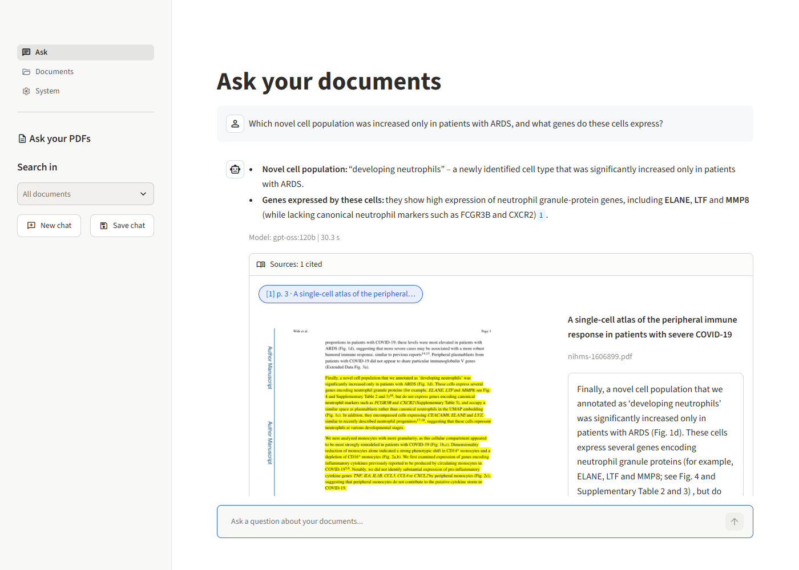
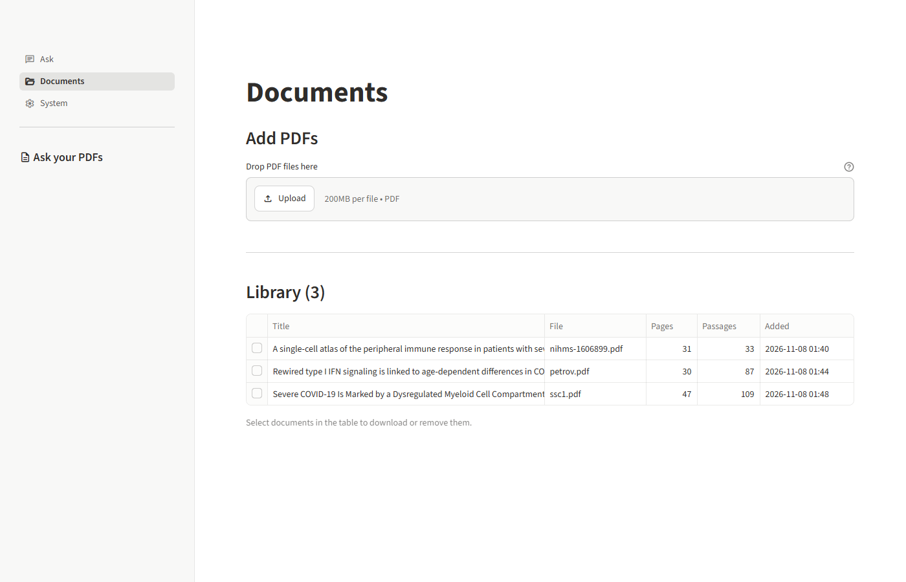
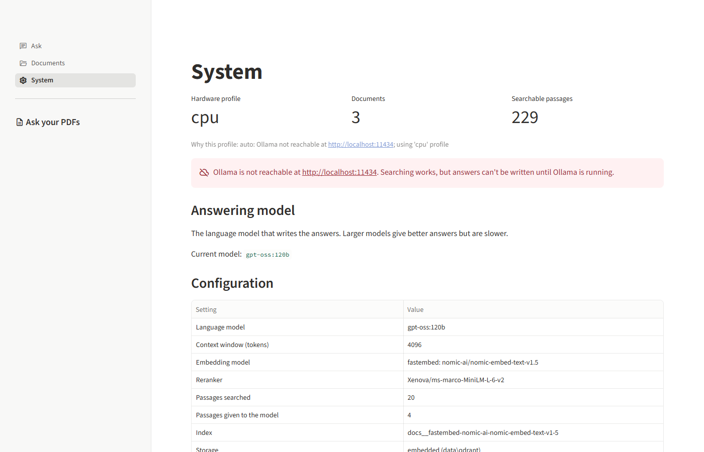

# PDF-RAG: The Complete Guide to the PDF Question-Answering System

*Project home: <https://github.com/Asimeng/PDF-RAG>*

*A plain-language guide to what this system does, how it works, how to install and run it, and how to fix it when something goes wrong.*

---

## Contents

1. [What is this?](#1-what-is-this)
2. [The big ideas, explained simply](#2-the-big-ideas-explained-simply)
3. [How the pieces fit together](#3-how-the-pieces-fit-together)
4. [Hardware profiles: one system, many computers](#4-hardware-profiles-one-system-many-computers)
5. [Installation, step by step](#5-installation-step-by-step)
6. [Using the app (the graphical interface)](#6-using-the-app-the-graphical-interface)
7. [Using the system (command line)](#7-using-the-system-command-line)
8. [Using the system from other programs (the API)](#8-using-the-system-from-other-programs-the-api)
9. [Settings you can change](#9-settings-you-can-change)
10. [Measuring quality (evaluation)](#10-measuring-quality-evaluation)
11. [A tour of the code](#11-a-tour-of-the-code)
12. [Why it was built this way (design decisions)](#12-why-it-was-built-this-way-design-decisions)
13. [Deploying on the GPU server](#13-deploying-on-the-gpu-server)
14. [Troubleshooting](#14-troubleshooting)
15. [Limitations and what comes next](#15-limitations-and-what-comes-next)
16. [Glossary](#16-glossary)

---

## 1. What is this?

You have a pile of PDF documents: research papers, manuals, reports, contracts. You want to ask questions such as:

> *"Which cell population was increased only in patients with ARDS?"*

and get back a **short, accurate answer that tells you exactly where it came from**:

> *A novel population of "developing neutrophils" was significantly increased only in patients with ARDS [1].*
>
> **Sources:** [1] nihms-1606899.pdf, page 3

That is what this system does. It reads your PDFs once, remembers what is in them, and then answers questions in everyday language. It always shows which document and page each answer came from, and can show you the original page with the passage highlighted, so you can check it yourself.

You use it through a simple **web app** in your browser (section 6). There is also a command line for technical users and an API for other programs.

**Important properties:**

| Property | What it means for you |
|---|---|
| **Private** | Everything runs on your own computer or server. Your documents are never sent to an outside company. |
| **Grounded** | It answers *only* from your documents. If the answer isn't there, it says so instead of making something up. |
| **Cited** | Every answer points to the file and page it used. |
| **Adaptable** | It runs on a modest laptop *and* on a powerful GPU server, choosing suitable AI models for each. |

The technical name for this kind of system is **RAG**, short for *Retrieval-Augmented Generation*.

---

## 2. The big ideas, explained simply

You don't need to understand these to *use* the system, but they will help you understand what it is doing and why.

### 2.1 Large Language Models (LLMs)

An **LLM** is the kind of AI behind chatbots. It has read a huge amount of text and is very good at writing fluent answers. It has two weaknesses:

1. **It doesn't know your documents.** It has never seen your PDFs.
2. **It can "hallucinate".** When it doesn't know something, it may confidently invent a plausible-sounding answer.

We run LLMs with **Ollama**, a free program that downloads and runs open AI models on your own hardware.

### 2.2 RAG: give the AI an open-book exam

RAG solves both weaknesses with a simple idea. Before the AI answers, we **find the relevant pages in your documents and hand them to it**, with strict instructions: *"Answer using only these passages, and say which one you used."*

Think of the difference between a closed-book exam, where the student answers from memory and might bluff, and an open-book exam, where the student is handed the right pages and must quote them.

RAG turns the AI's exam into an open-book one. The hard part, and most of this system, is **finding the right pages quickly and reliably**.

### 2.3 Chunks: cutting documents into index cards

A 40-page paper is far too long to hand to the AI for every question, and most of it is irrelevant to any one question. So when a PDF is added, we cut it into **chunks**: passages of up to about 450 tokens, roughly 340 words (a long paragraph or two).

It's like turning a book into a box of index cards. Each card carries a label: *which document, which page(s), which section heading*. Those labels are how the system can later tell you "page 3, Results section".

We cut *smartly*:
- We cut at paragraph and section boundaries, not mid-sentence.
- Consecutive cards **overlap** slightly, so a sentence that sits on a boundary isn't lost.
- We throw away noise: page headers and footers ("Cell 182, September 2020"), page numbers, text from inside figures, and reference lists (bibliographies match almost any question but never answer it).

### 2.4 Embeddings: turning meaning into numbers

How do we find the cards that are relevant to a question? Computers can't directly compare *meaning*, but they can compare numbers.

An **embedding model** is a small AI that turns a piece of text into a list of numbers (for example 768 of them) called a **vector**. It is trained so that **texts with similar meaning get similar numbers**, even if they use different words:

- "heart attack" and "myocardial infarction" → very similar vectors
- "heart attack" and "parking ticket" → very different vectors

So each card gets a vector, and each question gets a vector. Finding relevant cards becomes "find the cards whose numbers are closest to the question's numbers". This is called **semantic search** (search by meaning).

### 2.5 Keyword search (BM25): the classic approach

Semantic search has a blind spot: exact names, codes and rare terms. If you ask about "TNFRSF17" or "Seq-Well", meaning-based search may drift to vaguely related text.

So we *also* run classic **keyword search**, called **BM25**. It's the approach search engines have used for decades: cards that contain the question's words score higher, and rare words count more than common ones.

### 2.6 Hybrid search: the best of both

We run **both** searches and merge the results with a method called **Reciprocal Rank Fusion (RRF)**. A card ranked highly by *either* method rises to the top. This is called **hybrid search**, and it's standard practice in industry because each method catches what the other misses.

### 2.7 Reranking: a second, more careful look

Search is fast but approximate: it compares the question and each card *separately*. So we fetch a generous shortlist (20–50 cards) and then use a **reranker**. This is a different kind of AI model that reads the question *and* a card *together* and scores how well the card actually answers the question.

It's like a librarian who first pulls 30 possibly relevant books off the shelves, then reads the relevant page of each and keeps the best 4–10. Reranking is slower per card, but because it only looks at the shortlist it stays fast overall, and it noticeably improves accuracy.

### 2.8 The vector database (Qdrant)

All the cards, their vectors and their labels are stored in a **vector database**, a database built for "find the closest vectors" questions. We use **Qdrant**, a popular open-source one. On a laptop it simply stores files in the `data/qdrant` folder. On a server it can run as a separate service.

### 2.9 Citations and "I don't know"

The best cards are numbered `[1]`, `[2]`, … and given to the LLM with instructions to:
- use only these sources,
- put the source number after each statement,
- reply *"I couldn't find the answer to that in the provided documents."* if the sources don't contain it.

The system then checks which numbers the answer actually used, and marks those sources as **cited**.

### 2.10 Scanned pages and OCR

Most PDFs store their words as real characters, which the system reads directly. Some pages are just **pictures of text**: a scanned letter, or a table pasted into a report as an image. A computer sees only coloured dots there.

**OCR** (optical character recognition) is the technology that "reads" such pictures and turns them back into characters. The system uses **RapidOCR**, a small OCR engine that runs on an ordinary CPU, and applies it **only where it's needed**:

| What | OCR'd? | Why |
|---|---|---|
| Normal text pages | No | They already have real text |
| **Scanned pages** (almost no text, mostly image) | **Yes** | Otherwise the page would be invisible to search |
| **Tables saved as images** inside normal pages | **Yes** | The table becomes a real, searchable table |
| Figures, charts, photos | No | OCR'd figures only produce axis labels and tick numbers, noise that hurts search. On the sample papers, OCR'ing figures made reading **5–12 times slower** for no benefit |

How does it tell a table picture from a chart? A table almost always has **several horizontal lines across its full width** and is **black and white**. Charts are usually coloured and rarely have three full-width lines. This simple check matched every case in testing: the table image, and none of the 20 figures in the sample papers.

The recognised text is added to the system's working copy of the page as a hidden text layer. Your PDF file itself is never changed. When you open a cited scanned page in the web app, the passage is highlighted just like on a normal page.

---

## 3. How the pieces fit together

### 3.1 The journey of a PDF (adding a document, "ingestion")

```
 your.pdf
    │
    ▼
 ① READ        PyMuPDF extracts text page by page, keeping headings, lists, tables
    │          (scanned pages and tables saved as images are OCR'd first)
    │
    ▼
 ② CLEAN       remove headers/footers, page numbers, figure text, citation marks
    │
    ▼
 ③ CHUNK       cut into overlapping passages; label each with file, pages, section;
    │          skip reference lists
    ▼
 ④ EMBED       each chunk → (a) meaning vector  (b) keyword (BM25) weights
    │
    ▼
 ⑤ STORE       save chunks + vectors in Qdrant; record the file in the registry
               (with a fingerprint, so unchanged files are skipped next time)
```

### 3.2 The journey of a question

```
 "What did RNA velocity show?"
    │
    ▼
 ① REWRITE     (only in a conversation) turn a follow-up like "what about in
    │          children?" into a full standalone question
    ▼
 ② SEARCH      meaning search + keyword search → merged shortlist (20-50 chunks)
    │
    ▼
 ③ RERANK      cross-encoder re-scores the shortlist → best 4-10 chunks
    │
    ▼
 ④ PROMPT      numbered sources + strict instructions + the question
    │
    ▼
 ⑤ GENERATE    the LLM (via Ollama) writes the answer word by word ("streaming")
    │
    ▼
 ⑥ CITE        detect which [n] were used → answer + list of sources (file, page)
```

### 3.3 The layers of the software

```
   ┌───────────────────────────────────────────────────────────┐
   │  People:  web app (Streamlit)     │  command line (rag …) │
   ├───────────────────────────────────┴───────────────────────┤
   │  REST API (FastAPI)  - the "front desk" other programs use │
   ├───────────────────────────────────────────────────────────┤
   │  RAG pipeline  - ingestion, retrieval, generation          │
   ├──────────────┬──────────────┬──────────────┬──────────────┤
   │  PyMuPDF     │  fastembed   │  Qdrant      │  Ollama      │
   │  (read PDFs) │  (embeddings,│  (vector     │  (LLMs,      │
   │              │   reranker)  │   database)  │   embeddings)│
   └──────────────┴──────────────┴──────────────┴──────────────┘
```

---

## 4. Hardware profiles: one system, many computers

AI models come in sizes. Bigger models give better answers but need much more computing power. A model that answers in 3 seconds on a data-centre GPU might take several minutes on a laptop, or not fit in memory at all.

So the system has **profiles**: ready-made bundles of model choices for a class of hardware.

| Profile | For | Answering model (LLM) | Embedding model | Reranker | Passages given to LLM |
|---|---|---|---|---|---|
| `cpu` | Laptops & PCs without a GPU | `llama3.2:3b` (small, ~2 GB) | `nomic-embed-text-v1.5`, runs inside the app | MiniLM (tiny) | 4 |
| `gpu` | One GPU with ≥ 32 GB free memory | `qwen3.6:35b-a3b` (fast "mixture-of-experts") | `qwen3-embedding:0.6b` via Ollama | BGE reranker v2 (multilingual) | 8 |
| `gpu-max` | Data-centre GPU with ≥ 72 GB free (e.g. H100 80 GB) | `gpt-oss:120b` (largest, best answers) | `qwen3-embedding:0.6b` via Ollama | BGE reranker v2 | 10 |

### 4.1 `auto` mode

With `RAG_PROFILE=auto` (the default), the system decides for you at start-up:

1. Is there an NVIDIA GPU, and how much memory is free on the emptiest one?
2. Which models are installed in Ollama?
3. It picks the **most capable profile whose models are installed and fit in memory**, and prints why. For example:
   `auto: GPU with 79 GB free VRAM and required models installed -> 'gpu-max'`.

If Ollama is on *another* computer (a remote server), the system can't see that server's GPU memory, so it trusts that installed models can run there.

> **Port-forwarding catch:** if you reach the server's Ollama through a tunnel (SSH or VS Code port forwarding), it *looks* local (`localhost:11434`) and your laptop has no GPU, so `auto` picks `cpu`. In that case set the profile yourself, e.g. `RAG_PROFILE=gpu-max`, or keep the `cpu` profile and just choose a bigger answering model with `--llm gpt-oss:120b`.

You can always force a profile (`--profile cpu`) or override a single model (`--llm qwen3:32b`).

### 4.2 The one rule: embedding models and indexes belong together

- The **answering model (LLM)** can be switched at any time, even between questions. Nothing else changes.
- The **embedding model** can *not* be switched freely. Vectors from one embedding model are meaningless to another, like measuring some things in inches and others in centimetres and comparing the raw numbers.

To make this safe, **each embedding model gets its own separate index**, named after the model. For example `docs__fastembed-nomic-ai-nomic-embed-text-v1-5` for the laptop and `docs__ollama-qwen3-embedding-0-6b` for the GPU server. If you switch to a profile whose index is empty, the system tells you clearly:

> No documents are indexed for 'docs__ollama-qwen3-embedding-0-6b'. Documents exist in other indexes (…) built with a different embedding model - re-ingest them for the current profile.

Re-ingesting simply means running `rag ingest data/pdfs` again under the new profile.

> **Tip:** If you want one index that works on both your laptop and the server, set the same embedding model on both. For example, `RAG_EMBED_PROVIDER=fastembed` and `RAG_EMBED_MODEL=nomic-ai/nomic-embed-text-v1.5` on the server as well.

---

## 5. Installation, step by step

### 5.1 What you need

| Requirement | Why | How to check |
|---|---|---|
| **Python 3.11** (3.10–3.13 work) | The system is written in Python | `py -3.11 --version` (Windows) or `python3.11 --version` (Linux/macOS) |
| **Ollama** | Runs the answering AI models | `ollama --version` |
| **Git** | Downloads the project from GitHub ([github.com/Asimeng/PDF-RAG](https://github.com/Asimeng/PDF-RAG)). Without Git, use the green *Code → Download ZIP* button on that page and unzip it into a folder named `PDF-RAG` | `git --version` |
| ~3 GB free disk (laptop) | AI models + index | |
| Internet (first run only) | To download models | |

> Why not the newest Python (3.14)? Some AI libraries don't publish packages for brand-new Python versions straight away. Python 3.11 is the safe, well-supported choice.

### 5.2 Windows laptop

Open **PowerShell** and run these one at a time:

```powershell
# 0. Download the project and go into its folder
git clone https://github.com/Asimeng/PDF-RAG.git
cd PDF-RAG

# 1. Create an isolated Python environment (a private box for this project's libraries)
py -3.11 -m venv .venv

# 2. Activate it - your prompt will start with (.venv)
.\.venv\Scripts\Activate.ps1

# 3. Install the system and its libraries
pip install -e ".[dev]"

# 4. Create your settings file from the template
copy .env.example .env
```

If step 2 fails with "running scripts is disabled", run this once and try again:
`Set-ExecutionPolicy -Scope CurrentUser RemoteSigned`

**Install Ollama** from <https://ollama.com/download>, start it (it runs in the system tray), then download the small answering model:

```powershell
ollama pull llama3.2:3b
```

Check everything:

```powershell
rag status
```

You should see the profile, the models, and "Ollama: reachable".

### 5.3 Linux GPU server

```bash
git clone https://github.com/Asimeng/PDF-RAG.git
cd PDF-RAG
python3.11 -m venv .venv
source .venv/bin/activate
pip install -e ".[dev]"
cp .env.example .env

# Ollama is already installed on the server; make sure the models exist:
ollama list | grep -E "qwen3.6:35b-a3b|gpt-oss:120b|qwen3-embedding:0.6b"

rag status        # should report profile 'gpu' or 'gpu-max'
```

The first time the reranker is used it is downloaded automatically (~0.6–2 GB).

On the GPU server, also install the GPU version of ONNX Runtime so the reranker runs on the GPU. Otherwise it costs ~15 s per question (section 13.4):

```bash
pip uninstall -y onnxruntime && pip install "onnxruntime-gpu[cuda,cudnn]"
```

### 5.4 Using the laptop with the server's GPUs

You can run the app on your laptop but let the server do the heavy AI work. The server's Ollama must be reachable from the laptop. There are two ways:

- **SSH tunnel (safer, recommended):** run `ssh -N -L 11434:localhost:11434 you@server` on the laptop and keep it open. Ollama then appears at `http://localhost:11434` on the laptop, encrypted, and nothing is exposed to the network. Leave `RAG_OLLAMA_URL` at its default. VS Code's *Ports* panel does the same thing.
- **Open the port:** start Ollama on the server with `OLLAMA_HOST=0.0.0.0 ollama serve`, then put `RAG_OLLAMA_URL=http://<server-ip>:11434` in the laptop's `.env`. Only do this on a trusted network, because Ollama has no password protection.

Then choose the models: either set `RAG_PROFILE=gpu-max` in `.env` (see the notes below), or keep the `cpu` profile and borrow only the big answering model with `--llm`.

> **Forwarding the server's web app too?** If VS Code also forwards port 8501 (the server's copy of the app), that copy runs whatever code is on the server, not your local changes. `rag gui` on the laptop notices the busy port and starts your local copy on a free port instead. Use the address it prints.

Two things to know when mixing laptop and server:

- With `gpu`/`gpu-max`, **embeddings** are made by the server's Ollama (fast), but the **reranker** runs on the laptop's CPU. The large BGE reranker is very slow on a laptop, so add `RAG_RERANKER_MODEL=Xenova/ms-marco-MiniLM-L-6-v2` to keep the small one.
- A different embedding model means a separate index, so re-ingest your PDFs once (section 4.2). The simplest set-up is to keep the `cpu` profile (embeddings on the laptop) and only borrow the server's big answering model: `rag --llm gpt-oss:120b gui`.

---

## 6. Using the app (the graphical interface)

Most people will use the system through its **web app**: a page in your browser with a chat box, a document library and a settings page. No commands are needed after start-up.

### 6.1 Starting it

```bash
rag gui
```

This one command:

1. starts the API in the background if it isn't already running,
2. starts the web app and opens **<http://localhost:8501>** in your browser.

If port 8000 or 8501 is already taken by another program, it picks a free port automatically and prints the address to use.

Leave the terminal window open while you use the app. Press **Ctrl+C** in it to stop everything.

Useful variations:

```bash
rag --llm gpt-oss:120b gui        # choose the answering model
rag --profile gpu-max gui         # choose the hardware profile
rag gui --host 0.0.0.0            # let other computers on your network open it (see 6.5)
```

### 6.2 The Ask page



1. **Type a question** in the box at the bottom and press Enter. You can also click one of the example questions.
2. A status line shows what's happening: *Searching your documents…*, then *Found 4 relevant passages. Writing the answer…*
3. The **answer appears word by word**. Small blue numbers such as <kbd>1</kbd> are citations: each points to one of the sources below the answer.
4. Under the answer, **Sources** lists the passages the answer cited. Click a source to see:
   - **the real PDF page, with the passage highlighted in yellow**, so you can check the answer against the original in seconds,
   - the passage text and its section,
   - a **Download PDF** button.
5. **Follow-up questions work.** Ask "what about the healthy controls?" and the system understands it refers to the previous question. The caption under the answer shows the full question it actually searched for.

The sidebar has three useful controls:

| Control | What it does |
|---|---|
| **Search in** | Restrict questions to one or a few documents. Leave it empty to search everything |
| **New chat** | Start a fresh conversation (follow-ups forget earlier questions) |
| **Save chat** | Download the conversation, with its sources, as a text file |

> **How the highlighting works:** the stored passage text has been cleaned up, so it doesn't match the PDF letter for letter. The app lines up the two word sequences (like a "compare documents" tool) and highlights where they match. Runs of three or more matching words count, and small gaps such as a word hyphenated across lines are filled in. On **scanned pages** there are no words to line up with, so the page is OCR'd first (section 2.10). This takes a few seconds the first time a page is shown, and is cached after that. Highlighting is reliable for normal text, but occasionally a table or figure caption is only partly highlighted.

### 6.3 The Documents page



- **Add PDFs:** drag files onto the drop zone (or click *Upload*), then click **Add to library**. A progress bar shows each file being read, cut into passages and indexed. Files you have already added are recognised and skipped. If scanned pages or table images were read with OCR, the result says so (e.g. *"1 page read with OCR"*).
- **Library:** a table of all documents with their page and passage counts. Tick one or more rows to **Download** or **Remove** them. Removing asks for confirmation, and optionally deletes the PDF file as well.

### 6.4 The System page



Shows which hardware profile and models are in use, and **why** that profile was chosen. It also shows whether Ollama is reachable, and warns about missing models with the command to install them.

**Answering model** lets you switch the AI that writes answers, choosing from the models installed in Ollama. Bigger models write better answers but are slower. The switch applies to everyone using the same server, until it restarts. Searching is unaffected, so no re-indexing is needed.

> **Privacy:** Ollama can also offer *cloud* models (names ending in `:cloud`). These run on ollama.com, so your document passages would leave your computer. They are hidden from the list and blocked unless you set `RAG_ALLOW_CLOUD_MODELS=true`.

### 6.5 Sharing the app with colleagues

To let others on your network use the app, start it with `rag gui --host 0.0.0.0` (or set `RAG_GUI_HOST=0.0.0.0`), and give them the address `http://<your-computer's-IP>:8501`.

> **The web app has no login of its own.** Anyone who can reach port 8501 can read and delete documents. Only share it on a trusted network, or put it behind your organisation's login/VPN. User accounts are on the roadmap (section 15).

The app and the API can also run on different machines: set `RAG_API_URL=http://<server>:8000` where the app runs (and `RAG_API_KEY` if the API requires one).

---

## 7. Using the system (command line)

Activate the environment first (`.\.venv\Scripts\Activate.ps1` on Windows, `source .venv/bin/activate` on Linux). Every command has help: `rag --help`, `rag ingest --help`.

| Command | What it does |
|---|---|
| `rag status` | Shows the active profile, models, Ollama connection and how many documents are indexed |
| `rag profiles` | Lists all hardware profiles |
| `rag gui` | Opens the web app (section 6) and starts the API if needed |
| `rag ingest <files-or-folders…>` | Adds PDFs. Unchanged files are skipped automatically; add `--force` to redo them |
| `rag docs` | Lists indexed documents with their `doc_id` |
| `rag delete <doc_id>` | Removes a document from the index |
| `rag search "<question>"` | Shows the passages that would be given to the AI, **without** using the AI. Great for checking retrieval |
| `rag ask "<question>"` | Answers one question with sources |
| `rag chat` | Conversation mode with follow-up questions (`exit` to quit, `reset` to start over) |
| `rag eval` | Measures quality on a test set (see section 10) |
| `rag serve` | Starts only the API server (for other programs, or when the web app runs elsewhere) |

Global options go **before** the command:

```bash
rag --profile cpu ask "What is the main finding?"
rag --llm qwen3:32b chat
rag -v ingest data/pdfs          # -v shows detailed logs
```

### Example session

```text
> rag ingest data/pdfs
┌───────────────────┬─────────┬────────┬─────────┐
│ file              │ status  │ chunks │ seconds │
├───────────────────┼─────────┼────────┼─────────┤
│ nihms-1606899.pdf │ indexed │ 33     │ 57.7    │
│ petrov.pdf        │ indexed │ 87     │ 189.7   │
│ ssc1.pdf          │ indexed │ 109    │ 287.1   │
└───────────────────┴─────────┴────────┴─────────┘

> rag ask "Which cell population was increased only in patients with ARDS?"
A novel population annotated as "developing neutrophils" was significantly
increased only in patients with ARDS [1]. ...

 #   file               pages  section
 *1  nihms-1606899.pdf  3      ...
```

*(The ingestion times are real measurements from the laptop. The answer is illustrative: the exact wording depends on the model.)* A `*` marks sources the answer actually cited.

**How long does it take?** On the development laptop (2-core 2016 i7, no GPU), adding a 30–47 page paper took 1–5 minutes, and finding the passages for a question takes about 3–4 seconds. Writing the answer with a 3B model on such a CPU will add roughly a minute or more. On the H100 server everything is many times faster. Adding documents is a one-time cost per document.

---

## 8. Using the system from other programs (the API)

The **API** is a "front desk" that lets other programs, such as the web app, a website or a script, use the system over the network. The web app itself uses nothing but this API.

Start it:

```bash
rag serve                     # http://127.0.0.1:8000
```

Open **<http://127.0.0.1:8000/docs>** in a browser to get an interactive page where you can try every endpoint without writing code.

| Method & path | Purpose |
|---|---|
| `GET /health` | "Are you alive?" (for monitoring) |
| `GET /status` | Profile, models, index statistics |
| `GET /models` / `PUT /config/llm` | List Ollama models / switch the answering model live |
| `GET /documents` | List documents |
| `POST /documents` | Upload PDFs (processed in the background; returns a `job_id`) |
| `GET /jobs/{job_id}` | Upload progress (0–100 %) |
| `GET /documents/{doc_id}/file` | Download the original PDF |
| `POST /documents/{doc_id}/pages/{n}/image` | A page as a picture, with a passage highlighted (used for the evidence view) |
| `DELETE /documents/{doc_id}` | Remove a document |
| `POST /search` | Retrieval only |
| `POST /ask` | Question → answer with sources |
| `POST /ask/stream` | Same, but the answer arrives word by word (Server-Sent Events) |

Example with `curl`:

```bash
curl -X POST http://127.0.0.1:8000/documents -F "files=@report.pdf"
curl -X POST http://127.0.0.1:8000/ask -H "Content-Type: application/json" \
     -d '{"question": "What are the key findings?"}'
```

**Security:** by default the API only listens to your own computer (`127.0.0.1`). To let others connect, set `RAG_API_HOST=0.0.0.0` **and** set a password with `RAG_API_KEY=some-long-secret`. Clients then send the header `X-API-Key: some-long-secret`.

> In embedded mode only one program can open the index at a time. While `rag serve` or `rag gui` is running, use the web app or API, or stop it before using `rag ingest` or `rag ask`. (With a Qdrant server, as in the Docker setup, this limit disappears.)

---

## 9. Settings you can change

Settings live in the `.env` file (copy `.env.example`). Each line looks like `RAG_SETTING=value`. Lines starting with `#` are ignored. Restart the program after changing them.

| Setting | Default | What it does |
|---|---|---|
| `RAG_PROFILE` | `auto` | `auto`, `cpu`, `gpu` or `gpu-max` |
| `RAG_OLLAMA_URL` | `http://localhost:11434` | Where Ollama runs |
| `RAG_LLM_MODEL` | from profile | Answering model, e.g. `qwen3:32b` |
| `RAG_LLM_NUM_CTX` | from profile | How much text (tokens) the LLM can read at once |
| `RAG_LLM_TEMPERATURE` | `0.1` | Creativity. Low = factual and consistent |
| `RAG_EMBED_PROVIDER` | from profile | `fastembed` (inside the app) or `ollama` |
| `RAG_EMBED_MODEL` | from profile | Embedding model (**changing it requires re-ingesting**) |
| `RAG_RERANKER_MODEL` | from profile | Reranker, or `none` to switch it off |
| `RAG_TOP_K_RETRIEVE` | from profile | Shortlist size from search |
| `RAG_TOP_K_CONTEXT` | from profile | Passages given to the LLM |
| `RAG_MIN_RERANK_SCORE` | off | Drop passages the reranker scores below this |
| `RAG_OCR` | `auto` | OCR scanned pages and tables saved as images (`off` to disable) |
| `RAG_OCR_DPI` | `300` | OCR resolution. 300 reads small print far more reliably than 150 |
| `RAG_CHUNK_SIZE_TOKENS` | `450` | Chunk size (re-ingest with `--force` after changing) |
| `RAG_CHUNK_OVERLAP_TOKENS` | `60` | Overlap between chunks |
| `RAG_DATA_DIR` | `data` | Where index, models and PDFs are stored |
| `RAG_QDRANT_URL` | off | Use a Qdrant server instead of local files |
| `RAG_API_HOST` / `RAG_API_PORT` | `127.0.0.1` / `8000` | API address |
| `RAG_API_KEY` | off | Require a key for the API |
| `RAG_USE_CUDA` | auto | Run fastembed embeddings/reranker on GPU. Auto = on when `onnxruntime-gpu` is installed (section 13.4) |
| `RAG_ALLOW_CLOUD_MODELS` | `false` | Allow Ollama `:cloud` models, which send passages to ollama.com |
| `RAG_GUI_HOST` / `RAG_GUI_PORT` | `127.0.0.1` / `8501` | Web app address (`0.0.0.0` = reachable from other computers) |
| `RAG_API_URL` | from API host/port | Where the web app finds the API, if it runs on another machine |

**What is a token?** AI models read text in pieces called tokens. A token is roughly ¾ of an English word, so 450 tokens is about 340 words.

---

## 10. Measuring quality (evaluation)

"It seems to work" isn't good enough for a production system. We need **numbers**, so we can tell whether a change made things better or worse.

### 10.1 The test set

[`eval/questions.jsonl`](../eval/questions.jsonl) contains questions about the sample papers, each with the **correct file and page(s)** and **key facts** the answer must contain. It also includes questions that *cannot* be answered from the documents, to check that the system admits it rather than inventing an answer. Each line looks like:

```json
{"id": "wilk-02", "question": "Which novel cell population was significantly increased only in patients with ARDS?",
 "file": "nihms-1606899.pdf", "pages": [3], "must_include": ["developing neutrophils"]}
```

To evaluate your own documents, write 20–50 lines like this about them.

### 10.2 Running it

```bash
rag eval                         # retrieval only - fast, no LLM needed
rag eval --answers               # also generate and score answers
rag eval --judge gpt-oss:120b    # also have a big model check faithfulness
```

A report is saved in `eval/results/` as Markdown (for reading) and JSON (for comparing runs).

### 10.3 What the numbers mean

| Metric | Plain meaning | Good value |
|---|---|---|
| **Hit@k** | For what share of questions was a correct passage among the top *k* results? | as close to 100 % as possible |
| **MRR** | How high up was the first correct passage, on average? 1.0 = always first | > 0.7 |
| **Key-fact recall** | Did the answer contain the expected facts? | high |
| **Citation rate** | Did the answer cite its sources? | ~100 % |
| **Refusal accuracy** | For unanswerable questions, did it correctly say "I couldn't find…"? | ~100 % |
| **False refusals** | For answerable questions, did it wrongly give up? | low |
| **Faithfulness** | Is everything in the answer supported by the sources? (judged by a large LLM) | ~100 % |

### 10.4 Results on the sample papers

The evaluation compares four retrieval set-ups to show what each component adds. This kind of comparison is called an **ablation study**.

**Retrieval on the development laptop** (`cpu` profile, 3 papers, 229 chunks, 20 answerable questions). "Hit@4" matters most here, because the `cpu` profile gives the LLM the top 4 passages.

| Configuration | Hit@1 | Hit@3 | Hit@4 | MRR | Time per query |
|---|---|---|---|---|---|
| Meaning search only (dense) | 85 % | 95 % | 100 % | 0.904 | 0.16 s |
| Keyword search only (BM25) | 85 % | 95 % | 95 % | 0.900 | 0.10 s |
| Hybrid (both, merged) | 95 % | 95 % | 95 % | 0.950 | 0.09 s |
| **Hybrid + reranker (what the system uses)** | **100 %** | **100 %** | **100 %** | **1.000** | 3.4 s |

**Retrieval on the GPU server** (`gpu-max` profile: `qwen3-embedding:0.6b` embeddings, BGE reranker v2). This profile gives the LLM 10 passages, so "Hit@10" matters most.

| Configuration | Hit@1 | Hit@3 | Hit@10 | MRR | Time per query |
|---|---|---|---|---|---|
| Meaning search only (dense) | 85 % | 95 % | 100 % | 0.897 | 0.13 s |
| Keyword search only (BM25) | 85 % | 95 % | 100 % | 0.910 | 0.06 s |
| Hybrid (both, merged) | 95 % | 95 % | 100 % | 0.956 | 0.06 s |
| Hybrid + reranker | 90 % | 100 % | 100 % | 0.950 | 15.8 s |

**How to read this:**
- Each search method alone puts the right passage *first* for 85 % of questions. Combined, they reach 95 %. On the laptop, the reranker puts the right passage first for every question.
- On the server, **every set-up finds the right passage within the 10 given to the LLM**. The large BGE reranker shows no gain on this small test. Its 15.8 s per question was measured with the reranker running on the server's CPU; section 13.4 shows how to run it on the GPU. Whether BGE beats the small MiniLM reranker on harder questions is an open experiment.
- **Be careful with these numbers.** 20 questions is a small test (one question = 5 %), and they were written by the developer while looking at the papers, so they're likely easier than real users' questions. Treat the tables as evidence the pipeline works and as a baseline for comparing changes, not as a guarantee.

**Answer quality with `gpt-oss:120b`** (`rag eval --answers`, 20 answerable + 2 unanswerable questions; retrieval on the laptop, `gpt-oss:120b` on the GPU server):

| Metric | Result |
|---|---|
| Key-fact recall | 95 % |
| Citation rate | 100 % |
| Refusal accuracy (unanswerable questions) | 100 % |
| False refusals (answerable questions) | 0 % |
| Median seconds per answer | 33 |

Answer times varied between 8 and 35 seconds depending on how busy the shared GPU server was. In the web app, typical answers took 8–12 seconds.


---

## 11. A tour of the code

```
PDF-RAG/
├── src/ragapp/              the application (a Python "package")
│   ├── config.py            settings + hardware profiles
│   ├── hardware.py          GPU detection, Ollama model listing, auto profile choice
│   ├── schemas.py           data shapes: Chunk, Source, Answer, ...
│   ├── ingest/
│   │   ├── parser.py        PDF → clean page text (header/footer removal, title detection)
│   │   ├── ocr.py           reads scanned pages and table images (OCR), skips figures
│   │   └── chunker.py       text → overlapping, labelled chunks (skips reference lists)
│   ├── index/
│   │   ├── embeddings.py    meaning vectors (fastembed or Ollama) + BM25 keyword weights
│   │   ├── store.py         Qdrant: create, insert, delete, hybrid search
│   │   └── registry.py      SQLite list of indexed files with fingerprints
│   ├── retrieve/
│   │   ├── reranker.py      cross-encoder re-scoring
│   │   └── retriever.py     search → rerank → best passages
│   ├── generate/
│   │   ├── prompts.py       instructions to the LLM, source formatting, citation parsing
│   │   └── llm.py           talks to Ollama; streaming; hides "thinking" text
│   ├── pipeline.py          ties everything together (used by CLI and API)
│   ├── render.py            draws a PDF page with the cited passage highlighted
│   ├── evaluate.py          the quality measurement harness
│   ├── api.py               REST API
│   ├── cli.py               the `rag` command
│   └── gui/
│       ├── app.py           the web app (Streamlit): Ask, Documents, System pages
│       └── client.py        how the web app talks to the API
├── tests/                   automated tests (run: pytest)
├── eval/questions.jsonl     evaluation test set
├── docs/GUIDE.md            this guide
├── data/                    created at run time: index, models, PDF library
├── .env.example             settings template
├── pyproject.toml           package definition & dependencies
├── Dockerfile               container image
└── docker-compose.yml       one-command server deployment
```

**Automated tests.** Run `pytest`. There are 66 tests that check parsing, OCR, chunking, profile selection, citation parsing, evaluation scoring, page highlighting, the full pipeline, the API and the web app (driven headlessly with Streamlit's testing tool). They use tiny *fake* AI components, so they finish in about 30 seconds without Ollama or downloads. Run them after every change.

---

## 12. Why it was built this way (design decisions)

These are the choices an engineer would be asked about in an interview.

| Decision | Alternatives | Why this choice |
|---|---|---|
| **Plain Python pipeline**, no LangChain/LlamaIndex | Frameworks | Every step is visible and testable, with fewer dependencies and no framework churn. It also shows understanding of RAG rather than of a library. |
| **Hybrid search (dense + BM25) with RRF** | Dense only | Dense search misses exact terms (gene names, codes); BM25 misses paraphrases. Hybrid is the industry default. See the ablation in section 10. |
| **Cross-encoder reranking** | None, or LLM-based reranking | Large precision gain for small cost. It runs on CPU via ONNX, with no PyTorch. |
| **Qdrant** | Chroma, FAISS, pgvector | Native hybrid search (dense + sparse + fusion) in one query. Runs embedded (no server) on a laptop and as a server in production with the same code. |
| **fastembed (ONNX) for CPU embeddings** | sentence-transformers (PyTorch) | Much smaller install, fast on CPU. Means the laptop doesn't need Ollama just to index. |
| **Hardware profiles + auto-detection** | One fixed model | The same code serves a 2-core laptop and an 8×H100 server. |
| **One index per embedding model** | Single index | Prevents silently mixing incompatible vectors, a common production bug. |
| **Structure-aware chunking with page tracking** | Fixed-size character splits | Keeps paragraphs and tables intact and enables page-level citations. |
| **Selective OCR** (scanned pages and table images only) | OCR every image, or none | Scanned documents become searchable without slowing down normal PDFs. OCR'ing figures was measured: 5–12× slower and only adds noise. A cheap pixel check (rules + colour) separates tables from figures without an extra AI model. |
| **Noise removal** (headers, figure text, bibliographies) | Index everything | Bibliographies and headers match many queries lexically and crowd out real answers. Measured improvement in retrieval. |
| **Contextual chunk headers** (document title + section prepended before embedding) | Raw chunk text | A chunk saying "levels were elevated" still "knows" which paper and section it belongs to. |
| **Content fingerprints (SHA-256)** | Re-index everything | Incremental updates: unchanged files are skipped, and changed files replace their old version. |
| **Grounded prompt with explicit refusal** | Free-form answers | Reduces hallucination. Refusals are measured in evaluation. |
| **FastAPI service layer** | GUI calling Python directly | Clear separation, so any front end (GUI, web, Slack bot) can use it. Gives auto-generated docs, streaming, background jobs and API keys. |
| **Evaluation harness with ablations** | Manual spot checks | Quality changes are measured, not guessed. |
| **Streamlit web app as a thin client of the API** | React front end; GUI calling Python directly | Streamlit gives a clean, accessible UI in pure Python. Because it only talks to the API, the app and the AI can run on different machines, and a React front end could replace it later without touching the core. |
| **Evidence view: the real page with the passage highlighted** | Show only the passage text | Non-technical users trust what they can verify. Matching the cleaned passage back to the PDF uses sequence alignment (the idea behind `diff`), because the text no longer matches letter for letter. |
| **Citation normalisation** | Trust the model's format | Different models cite differently (`gpt-oss` writes `【1†L3-L7】`). Normalising them to `[1]` keeps citations clickable and measurable for any model. |
| **Cloud models blocked by default** | Allow everything Ollama offers | "Your documents never leave your hardware" must hold even when someone picks the wrong model from a list. |

---

## 13. Deploying on the GPU server

### 13.1 Option A: directly with Python (simplest)

Follow section 5.3, then:

```bash
RAG_PROFILE=gpu-max RAG_API_HOST=0.0.0.0 RAG_API_KEY=<secret> rag serve
```

### 13.2 Option B: Docker (recommended for long-running use)

Docker packages the app and its dependencies into a container that runs identically anywhere. The included `docker-compose.yml` starts:

- **qdrant**: the vector database as a proper server (several processes can use it at once),
- **app**: the RAG API, talking to the Ollama already installed on the server,
- **gui**: the web app on port **8501**, reaching the API over Docker's internal network.

```bash
cp .env.example .env          # set RAG_PROFILE=gpu-max and RAG_API_KEY=...
docker compose up -d --build
docker compose logs -f app    # watch it start; Ctrl+C to stop watching
```

The web app is then on `http://<server>:8501` and the API on `http://<server>:8000`. Re-ingest your PDFs once on the server, because the GPU profile uses a different embedding model:

```bash
curl -X POST http://<server>:8000/documents -H "X-API-Key: <secret>" -F "files=@paper.pdf"
```

Users only need port 8501 opened to them. Remember that the web app has no login (section 6.5).

### 13.3 Sharing GPUs with others

For servers with several GPUs, some are often fully busy. To keep the AI models on idle GPUs, tell Ollama which GPUs to use before starting it:

```bash
CUDA_VISIBLE_DEVICES=0,2 ollama serve
```

`auto` mode looks at the GPU with the most free memory when choosing a profile. `gpt-oss:120b` needs roughly 65–70 GB on one GPU. If none is free enough, `auto` falls back to `gpu` (`qwen3.6:35b-a3b`, ~23 GB).

### 13.4 Making the reranker use the GPU

The reranker and the fastembed models run through **ONNX Runtime**. The normal package only uses the CPU, where the large BGE reranker takes about **15 seconds per question**. With the GPU version it takes well under a second:

```bash
pip uninstall -y onnxruntime
pip install "onnxruntime-gpu[cuda,cudnn]"     # brings its own CUDA libraries
python -c "import onnxruntime as o; print(o.get_available_providers())"   # should list CUDAExecutionProvider
```

`RAG_USE_CUDA` is on automatically once this works. In Docker, build with `WITH_CUDA: "true"` and uncomment the `deploy:` GPU section in `docker-compose.yml`. On a shared server, choose the GPU with `CUDA_VISIBLE_DEVICES`, just as for Ollama.

---

## 14. Troubleshooting

| Problem | Likely cause | Fix |
|---|---|---|
| `rag: command not found` / `not recognized` | Environment not activated | `.\.venv\Scripts\Activate.ps1` (Windows) or `source .venv/bin/activate` |
| "Cannot reach Ollama at http://localhost:11434" | Ollama not running | Start the Ollama app, or run `ollama serve` |
| "Model 'xyz' is not installed" | Model not downloaded | `ollama pull xyz` |
| "No documents are indexed for '…'" | Nothing ingested *for this embedding model* | `rag ingest data/pdfs` under the current profile |
| "The index folder is in use by another process" | `rag serve` or `rag gui` is running | Use the web app or API, or stop it first |
| A PDF shows `failed: No extractable text found … install the OCR engine` | The OCR engine is missing | `pip install rapidocr` (normally installed automatically) |
| A PDF shows `failed: No readable text found, even with OCR` | Blank pages or a very poor scan | Rescan at a higher resolution (300 dpi or more) |
| A scanned PDF is slow to add | OCR runs on the CPU, several seconds per page | Normal; it's a one-time cost per document |
| A table that is an image wasn't read | Tables without horizontal lines, or coloured tables, look like figures | Known limitation (section 15) |
| A PDF shows `failed: password-protected` | Encrypted PDF | Remove the password and re-add it |
| Answers are slow | Big model on weak hardware | Use `--profile cpu`, a smaller `--llm`, or point to the GPU server |
| Answer says "couldn't find" but the info is there | Retrieval missed it | Run `rag search "<question>"` to see what was found. Try rephrasing, or raise `RAG_TOP_K_CONTEXT` |
| Strange characters in the terminal | Windows console encoding | Run `chcp 65001` or use Windows Terminal |
| First run is slow | Models being downloaded | One-time only |
| Web app says "Can't reach the service" | The API isn't running, or runs elsewhere | Start with `rag gui` (starts both). If the API is on another machine, set `RAG_API_URL` |
| "Port 8000/8501 is in use by another program" | Another program (e.g. VS Code port forwarding) uses it | Nothing to do: `rag gui` picks a free port and prints the address. For `rag serve`, set `RAG_API_PORT` |
| The app in the browser doesn't show your latest changes | You opened a forwarded port (the server's copy of the app) | Open the address `rag gui` printed for your local copy |
| The browser didn't open | Running on a server, or blocked | Open the address `rag gui` printed (normally <http://localhost:8501>) |
| Page preview says "unavailable" | The original PDF was deleted from `data/pdfs` | Re-add the PDF on the Documents page |
| Highlight covers only part of a passage | Tables, captions or unusual layouts | The passage text in the panel next to it is always complete |
| "…is a cloud model" error | A `:cloud` model was chosen | Pick a local model, or allow cloud models (section 9) if that's acceptable |
| Answering takes ~15 s longer than expected on the server | Reranker running on CPU | Install `onnxruntime-gpu` (section 13.4) |
| Out-of-memory error while adding documents | Not enough free RAM | Close other programs and add the files again. Embedding batches on CPU are already kept small |

---

## 15. Limitations and what comes next

**Current limitations**
- **OCR** reads scanned pages and table images, but handwriting and poor scans give errors. Tables drawn without horizontal lines, or in colour, may be mistaken for figures and skipped. The first time the engine runs it downloads its models (~15 MB); the Docker image includes them already.
- **Figures and charts** aren't "seen": only their captions and surrounding text are used.
- **Complex tables** are kept as text tables and usually work, but very wide or merged-cell tables can be garbled.
- **Question rewriting** in conversations adds one extra LLM call per follow-up.
- In embedded mode, one process at a time can use the index (use the Qdrant server for multi-user setups).
- The web app has **no login**: anyone who can open it can see and remove documents.
- Switching the answering model in the web app affects **all** users of that server.

**Roadmap**
1. ~~**Web app** for non-technical users~~ ✓ done: drag-and-drop upload, chat, sources that open the PDF page with the passage highlighted, model switcher.
2. **Login and per-user document collections** for shared deployments (the web app currently has no login).
3. ~~OCR for scanned pages and table images~~ ✓ done.
4. Figure understanding with a vision model (describe charts so they can be searched), on GPU profiles.
5. One-click launcher for Windows (double-click instead of `rag gui`).
6. GPU reranking by default in the Docker image.

---

## 16. Glossary

| Term | Meaning |
|---|---|
| **API** | A way for programs to talk to each other. Here: web addresses like `/ask` that accept questions and return answers. |
| **BM25** | A classic keyword-scoring formula used by search engines. |
| **Chunk** | A passage of a document (about one or two paragraphs) that is stored and searched. |
| **Citation** | The `[n]` marker linking a statement to a source passage. |
| **Context window** | How much text an LLM can read at once, measured in tokens. |
| **Cross-encoder / reranker** | A model that reads a question and a passage together and scores relevance. |
| **CUDA** | NVIDIA's technology for running computations on GPUs. |
| **Docker** | A tool that packages software into containers that run the same everywhere. |
| **Embedding / vector** | A list of numbers representing the meaning of a text. |
| **Hallucination** | When an AI confidently states something false or invented. |
| **Hybrid search** | Combining meaning-based and keyword-based search. |
| **Ingestion** | Adding documents to the system (read, clean, chunk, embed, store). |
| **LLM** | Large Language Model: the AI that writes answers. |
| **MoE (mixture of experts)** | A model design where only part of the model is used per word, making large models faster. |
| **OCR** | Optical character recognition: software that reads text from a picture of text. |
| **Ollama** | Free software that downloads and runs open AI models locally. |
| **ONNX** | A portable format for AI models that runs efficiently on ordinary CPUs. |
| **Port** | A numbered "door" on a computer that a program listens on, e.g. 8501 for the web app. |
| **Profile** | A bundle of model choices suited to a class of hardware. |
| **Qdrant** | The vector database used to store and search chunks. |
| **RAG** | Retrieval-Augmented Generation: look up relevant passages first, then have the AI answer from them. |
| **RRF** | Reciprocal Rank Fusion: a simple way to merge two ranked lists. |
| **SSH tunnel / port forwarding** | A secure way to make a program on another computer appear as if it ran on yours. |
| **Streaming** | Showing the answer word by word as it is generated. |
| **Streamlit** | A Python library for building web apps; used for the graphical interface. |
| **Token** | A piece of a word that AI models read; about ¾ of an English word. |
| **Virtual environment (venv)** | A private folder of Python libraries for one project, so projects don't interfere. |
| **VRAM** | The memory on a graphics card (GPU). Large models need lots of it. |
